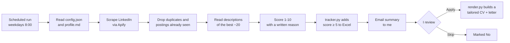
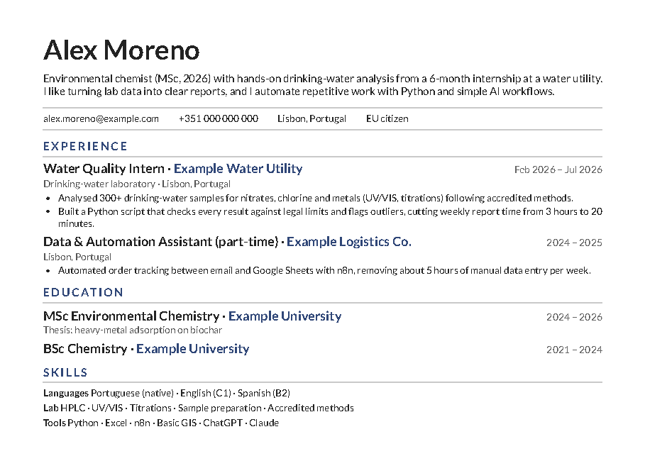

# AI Job Search Agent

An AI agent that runs my job search every weekday morning: it finds new postings, scores them against my profile, adds the good ones to my tracker and emails me a short summary. **It never applies on its own.** Every application goes through me first.

I built it with Claude Code during my own job search after an MSc in Chemistry, and I used it daily during my search.

## Why

Applying by hand meant hours on job boards, re-reading the same postings and losing track of what I had already sent. The scraping part is easy. The hard part is judgement: which postings are actually worth my time, and why. This agent writes that judgement down as a rubric, applies it every morning, and leaves the final decision to me.

## How it works



1. **Scrape.** Runs every search in `config.json` through an Apify LinkedIn scraper.
2. **Filter cheaply, then read.** Light fields first (title, company, level), full descriptions only for the most promising ~20. This keeps runs fast and cheap.
3. **Score.** Claude scores each posting from 1 to 10 against the rubric in `profile.md` and writes one line: why it fits, and the main risk (language, years of experience, visa).
4. **Track.** `tracker/tracker.py` writes the postings into a spreadsheet, skips anything already seen or already applied to, and backs up the file first.
5. **Summarise.** I get an email with the postings that scored 7 or more.
6. **Decide.** I choose what to apply to. For those, `documents/render.py` turns a tailored JSON into a one-page CV and cover letter.

## Design decisions

- **Human in the loop.** The agent proposes; I decide. It cannot apply, message employers or email anyone but me. These limits are written into the prompt as hard rules.
- **Instructions, settings and profile are separate.** `agent/daily_search.md` says *how* to work, `config.json` holds the settings, `profile.md` describes *who* the candidate is. Anyone can reuse the agent by writing their own profile.
- **The rubric is the product.** Rules like *"asks for 2+ years even if it says graduates are welcome → score low"* came from months of real applications. They live in plain language in `profile.md`, so they are easy to read and change.
- **Code does the risky parts.** The model never edits the spreadsheet directly. A small, tested script does, with backups, duplicate checks and a guard that stops if the file is open in Excel (a bug that once cost me a row).
- **Content and layout are separate.** A tailored CV is just a JSON file; one stylesheet controls the design for every document.
- **Posting text is treated as data.** If a job description contains instructions aimed at the agent, they are ignored (prompt-injection defence).

## Repository

```
agent/daily_search.md      the agent's instructions
config.example.json        settings template (copy to config.json)
profile.example.md         profile + scoring rubric template (copy to profile.md)
tracker/tracker.py         spreadsheet helper: dedupe, backup, write rows
documents/render.py        JSON -> one-page PDF CV or cover letter
documents/templates/       shared stylesheet
examples/                  a fictional candidate's CV and letter
tests/                     unit tests
```

Your own `config.json`, `profile.md`, spreadsheets and generated PDFs are git-ignored and never leave your machine.

## Setup

Requirements: Python 3.10+, Google Chrome (for PDFs), [Claude Code](https://claude.com/claude-code) with the Apify connector, and optionally a Gmail connector for the summary email.

```bash
git clone https://github.com/giulianapitronaci-sudo/ai-job-search-agent.git
cd ai-job-search-agent
pip install -r requirements.txt

cp config.example.json config.json   # your searches, tracker path, email
cp profile.example.md profile.md     # who you are + your scoring rubric
```

Then schedule a daily Claude Code task with this prompt:

> Work from the repository root. Read `agent/daily_search.md` and follow it step by step.

## Usage

```bash
# What the tracker already knows
python3 tracker/tracker.py seen

# Build a CV or cover letter from JSON
python3 documents/render.py cv     examples/cv.example.json     output/cv.pdf
python3 documents/render.py letter examples/letter.example.json output/letter.pdf

# Run the tests
python3 -m unittest -v
```



## What I learned

- Writing a good rubric took more iterations than writing the code.
- Agents need guardrails that live outside the prompt: backups, duplicate checks and file locks in code, not just "be careful" in the instructions.
- Separating data from logic is what turned a personal script into a tool someone else could use.

## Author

Giuliana Pitronaci · MSc Chemistry (KU Leuven) · building AI automations for real workflows.
[GitHub](https://github.com/giulianapitronaci-sudo)
